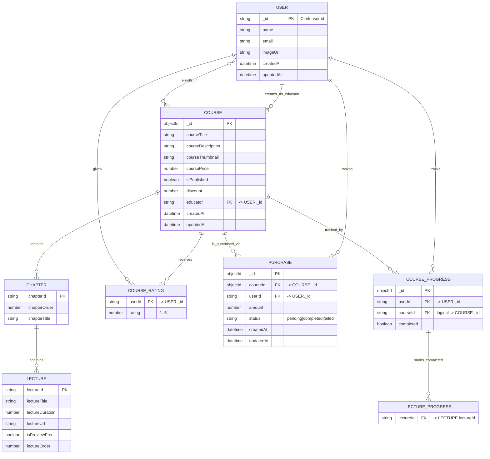

# LMS Entity-Relationship Model

This diagram models the MongoDB entities used by the backend, including embedded structures and cross-entity references.

## Notes

- `USER.enrolledCourses` stores an array of `Course._id` values.
- `COURSE.enrolledStudents` stores an array of `User._id` values.
- `COURSE.educator` references `User._id` (string, aligned with Clerk user id).
- `COURSE.courseContent` is embedded course structure represented by `CHAPTER` and `LECTURE` in the diagram.
- `COURSE.courseRatings` is an embedded array represented by `COURSE_RATING` in the diagram.
- `COURSE_PROGRESS.courseId` is stored as string in schema, but used logically as a reference to `COURSE._id`.
- `COURSE_PROGRESS.lectureCompleted` is represented by `LECTURE_PROGRESS` as a logical list of completed lecture ids.
